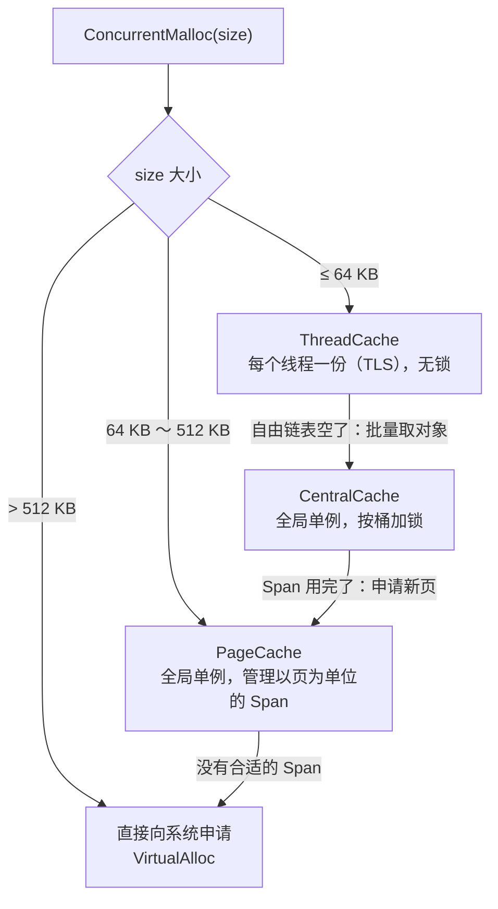

# 高并发内存池 concurrent_memory_pools

参考 Google **tcmalloc** 的思路，用 C++ 实现的一个简化版高并发内存池。小对象分配大部分时候只访问线程自己的缓存，不加锁，从而减少多线程下 `malloc` / `free` 的锁竞争。

## 整体结构

| 层 | 职责 | 关键点 |
|---|---|---|
| **ThreadCache** | 每个线程一份，按对象大小分桶的自由链表 | 线程局部存储，分配和释放都不加锁；一个桶里对象太多时还给 CentralCache |
| **CentralCache** | 全局单例，按桶管理 Span | 每个桶一把锁（桶锁），不同大小的分配互不影响；一次批量给 ThreadCache 一批对象 |
| **PageCache** | 全局单例，按页数管理 Span | 大 Span 切分出小 Span；释放时合并相邻空闲页，减少外部碎片；维护页号到 Span 的映射 |

## 代码说明

| 文件 | 内容 |
|---|---|
| `Common.h` | 公共定义：`FreeList` 自由链表、`SizeClass` 对齐与桶下标计算、`Span` / `SpanList`、系统内存申请 |
| `ThreadCache.h/.cpp` | 线程缓存的申请与释放，向中心缓存批量取对象 |
| `CentralCache.h/.cpp` | 中心缓存：从 Span 中切对象、回收对象，Span 全部回收后还给页缓存 |
| `PageCache.h/.cpp` | 页缓存：Span 的分裂与合并，`_idSpanMap` 页号映射 |
| `ConcurrentMalloc.h` | 对外接口 `ConcurrentMalloc` / `ConcurrentFree`，按大小分流 |
| `Test.cpp` | 对齐规则、系统申请和线程缓存的单元测试 |

几个常量（见 `Common.h`）：

- `MAX_SIZE = 64 KB`：ThreadCache 负责的最大对象
- `NFREE_LIST = MAX_SIZE / 8`：自由链表桶数
- `MAX_PAGES = 129`、`PAGE_SHIFT = 12`：页大小 4 KB，PageCache 最多管理 128 页的 Span

## 如何运行

项目使用 Windows 的 `VirtualAlloc` 申请大块内存。用 Visual Studio 新建空的控制台工程，把所有 `.h` / `.cpp` 加进去，以 `Test.cpp` 为入口编译运行即可。

## 可以继续改进的地方

- [ ] 用 `mmap` / `munmap` 适配 Linux
- [ ] 用基数树代替 `std::map` 做页号映射，去掉 PageCache 查表时的锁
- [ ] 增加与 `malloc` / `free` 在多线程下的性能对比测试

## 相关文章

学习笔记整理在 CSDN：[海盗船长y 的博客](https://blog.csdn.net/weixin_44826356)
